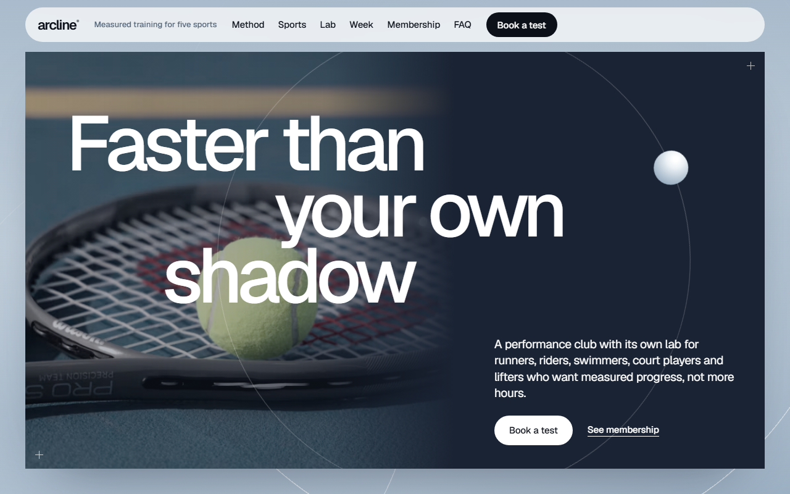
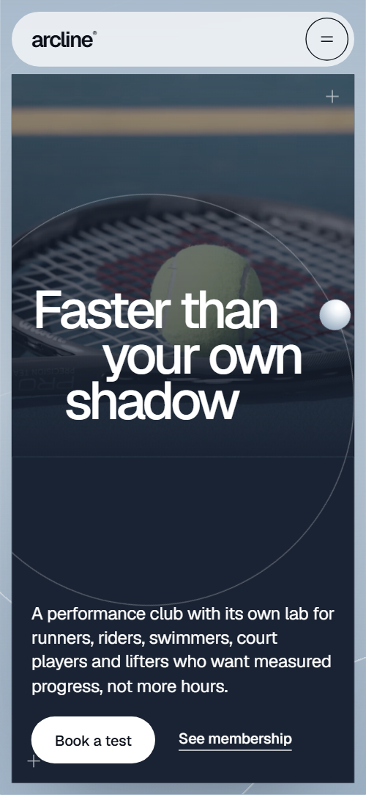
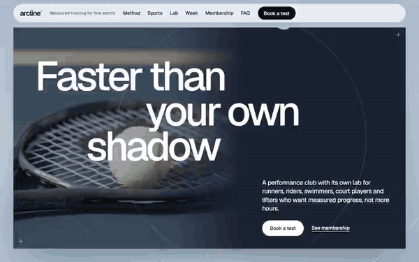

# Free HTML fitness website template with scroll animations and no libraries

Fitness website template: a one-page site for a gym, training club or coaching studio, with a test lab, four coaches, a seven day schedule that scrolls sideways, three plans and a booking form. Framed white, navy and pale slides float on a misty blue-grey page. The scroll motion runs on CSS with no JavaScript libraries, in one 27 KB gzipped file that Claude Code, Cursor or Codex can adapt.

[](LICENSE)  

**[Live demo](https://8bsite.github.io/fitness-website-template/)** · **[Use this template](https://github.com/new?template_name=fitness-website-template&template_owner=8bsite)** · **[Download ZIP](https://github.com/8bsite/fitness-website-template/archive/refs/heads/main.zip)** · **[Template page on 8b.com](https://8b.com/templates/arcline/)**

<a href="https://8bsite.github.io/fitness-website-template/"></a> <a href="https://8bsite.github.io/fitness-website-template/"></a>

<p align="center"><a href="https://8bsite.github.io/fitness-website-template/"></a><br><sub>Scroll animation</sub></p>

## Use it with Claude Code, Cursor or Codex

Download the four files into your project folder (`curl.exe` in Windows PowerShell):

```bash
curl -LO https://raw.githubusercontent.com/8bsite/fitness-website-template/main/index.html
curl -LO https://raw.githubusercontent.com/8bsite/fitness-website-template/main/AGENTS.md
curl -LO https://raw.githubusercontent.com/8bsite/fitness-website-template/main/LICENSE
curl -LO https://raw.githubusercontent.com/8bsite/fitness-website-template/main/CREDITS.md
```

Then fill in the angle brackets and give your agent this prompt:

```text
Read AGENTS.md, then edit index.html. Make it the site for <my gym, club or coaching business: sports, address, hours, coaches and qualifications, weekly schedule with times, plans with monthly prices, first test price, how people book>. Replace first the brand name, the three plans, the seven day cards and the four coaches. Keep the section ids, the classes AGENTS.md lists, the gate script in the head and the data-8b-* attributes; motion is CSS scroll-driven animation plus the inline kit, so add no animation library. The collage holds eight tiles; set each --len to its line's new character count. Never invent prices, hours, addresses, qualifications, results or contacts; ask me.
```

In a vibe coding session with Claude Code, Cursor or Codex, start with the facts only the club can supply: plan names, monthly prices and pause terms, class times and rooms, coach names and qualifications, address, opening hours and a booking link. The member quotes, race times, lab equipment list and the claim that every coach holds a degree are invented, so the agent should ask for real ones or delete them. Search for the old name in any letter case, because the wordmark is lower case. Drop the ® signs unless the marks are registered. Cursor users can follow [the steps for Plan mode](https://8b.com/templates/for-cursor/) and its prompts.

No agent? Click **[Use this template](https://github.com/new?template_name=fitness-website-template&template_owner=8bsite)**, edit `index.html` on GitHub and turn on **Settings > Pages**.

## Sections and motion

- **Navigation**: top bar: wordmark, a short tagline, section links, Book a test button; phone menu overlay.
- **Faster than your own shadow**: two-screen opening: a navy cover slide with a photo and a three-line stepped headline, then a pale manifesto slide (demo: racket photo, "Only forward®"). Smooth wheel scrolling with a mouse throughout. On load the frame opens and the headline lines slide in. While the cover holds, its lines streak off sideways, the photo zooms and the slide shrinks and darkens; the next heading streaks in.
- **Tested Monday. Faster by spring**: how it works: three numbered steps beside a big heading with round photos set into its lines (demo: Test, Train, Transfer). Tied to scroll, three round photos roll into gaps in the heading while the words after the first two photos slide into place.
- **Breathe. Move. Repeat.**: a three-word line over a collage of tiles, one per activity, plus a link tile (demo: strength, running, cycling, swimming, gait fitting, court sports). Tied to scroll, the tiles start as a tilted pile in the middle and are dealt out to their places.
- **Coached by people who still race**: four coach portraits of different heights with names and roles. Two rings draw and turn with scroll, and each portrait settles from a slight zoom.
- **What the lab sees**: a feature block: text on the left, a round photo ringed by four labelled measures on the right (demo: test lab, VO₂ max, threshold). Tied to scroll, a round lens opens on the lab photo from a small circle and, on wide screens, four measures swing around it.
- **A week at Arcline**: weekly schedule: seven day cards in a row that runs sideways as you scroll, with a progress line. The stage holds in place while the seven day cards run sideways as you scroll, leaning into faster scrolls, and a progress line fills.
- **Members, retested**: testimonials: one large quote with a round portrait in its first line and two short quotes. The large quote streaks in from the left, its round portrait settles from a slight zoom and the two short quotes rise in.
- **Recovery is part of the rep**: a stepped heading, a lead and four services in two columns, beside a window of sky over calm water (demo: recovery suite). Tied to scroll, a pale sun sinks into the window, the sky fades from navy to pale blue-grey and the water settles.
- **Membership**: pricing: three plans in ruled columns, the middle one highlighted. Rings draw and turn with scroll, the heading streaks in and the three plans rise one after another.
- **Before your first test**: questions and answers (native &lt;details&gt;) beside a rail with a rolling ball. Tied to scroll, a ball rolls down the rail beside the questions, turning as it travels.
- **Book your first test**: booking: a heading on a line across the slide, address, hours, phone, email and a short form (placeholders). Tied to scroll, the heading slides along its line to the right while the line stretches to full width.
- **Footer**: width-filling wordmark, a line about the club, links, socials, copyright and the Design: 8B credit. The width-filling wordmark streaks in from the left, skewed and stretched, as the footer comes into view.

## Design

 white slides  
 text and dark buttons  
 navy slides  
 misty page background  
 blue-grey mist, rules, rings  
 slate secondary text  
 cobalt blue for keyboard focus rings (white on navy slides) and focused form fields  
 pale panels and fields

**Geist**: all text: medium-weight headings set very large with tight negative tracking (Google Fonts). Each section from the opening to the footer is a framed slide with corner crosshairs and a soft shadow, floating on a fixed blue-grey mist crossed by thin circles; in the week section each day card is its own slide. White, navy and pale slides are mixed down the page and step left or right. Photos are desaturated, round photo chips sit inside heading lines and pale spheres act as ornaments.

## Questions

**Does the booking form send anything?**  
No. It requires a name and a valid email, then shows a thank-you line and clears itself, but nothing leaves the page. Connect Formspree or Netlify Forms, or remove the form and keep the email link. AGENTS.md has the steps. The line promising a coach will call within one working day is invented, so edit it too.

**Is this website design for personal trainers or only for gyms?**  
Both. A solo coach can use it as a personal trainer website template: keep the method, schedule, plans and booking [in the same single scroll](https://8b.com/templates/one-page/), and swap the four coach portraits for one or two, or remove the coaches section with the steps in AGENTS.md. Rename the lab block as an assessment or trial session. The five sports are only demo copy.

**Is the weekly schedule easy to change?**  
Yes. Each day is a plain list item with a session name, a time and place, a short note and a photo. Add or remove cards and the sideways scroll recalculates its length when the page loads or resizes. Each card holds one session, so a long timetable needs another layout or a link to your booking system.

## Is it the right base?

Choose this base when you sell coached training with a structure: an entry test, a block of weeks, a retest and monthly tiers. A venue selling timed passes and parties fits the [indoor activity venue](https://8b.com/templates/hopla/) template better. This light build keeps the look and scroll behaviour with no animation library and no script from a CDN: 27 KB of gzipped code in one file, against about 72 KB and three extra requests for the GSAP version. The weak spot: each day card holds one session, so a dozen classes a day need another layout or a booking link, and the plan buttons lead to the form, not a checkout.

## Before you publish

- Replace what is marked `data-8b-placeholder` (social preview image, favicon, phone, email, form, social) and the invented demo facts; [AGENTS.md](AGENTS.md) lists them.
- The form sends nothing yet: connect it to Formspree or Netlify Forms, or remove it.

## Tech

No JavaScript libraries: CSS scroll-driven animations and a small inline motion script with its own smooth wheel scrolling, 103 KB, no build step. Chrome and Edge 111+, Safari 16.2+, Firefox 113+ (it uses color-mix(), container query units, cascade layers, small/dynamic viewport units). Without scroll-driven animations (Firefox today) the scroll motion and the smooth wheel are off and each section shows its finished layout, while any load-in or looping animation still plays; with "reduce motion" on, the page is complete and nothing moves on its own (hover effects stay).

A GSAP build of the same page is [`index.gsap.html`](index.gsap.html): GSAP 3.13.0, ScrollTrigger, Lenis 1.3.27 from jsDelivr, 91 KB; its scroll motion also plays in Firefox. Use one of the two files.

## License

MIT, see [LICENSE](LICENSE). Photos, fonts and libraries keep their own licences: [CREDITS.md](CREDITS.md). More free templates: [8b.com/templates](https://8b.com/templates/) · [github.com/8bsite](https://github.com/8bsite).
