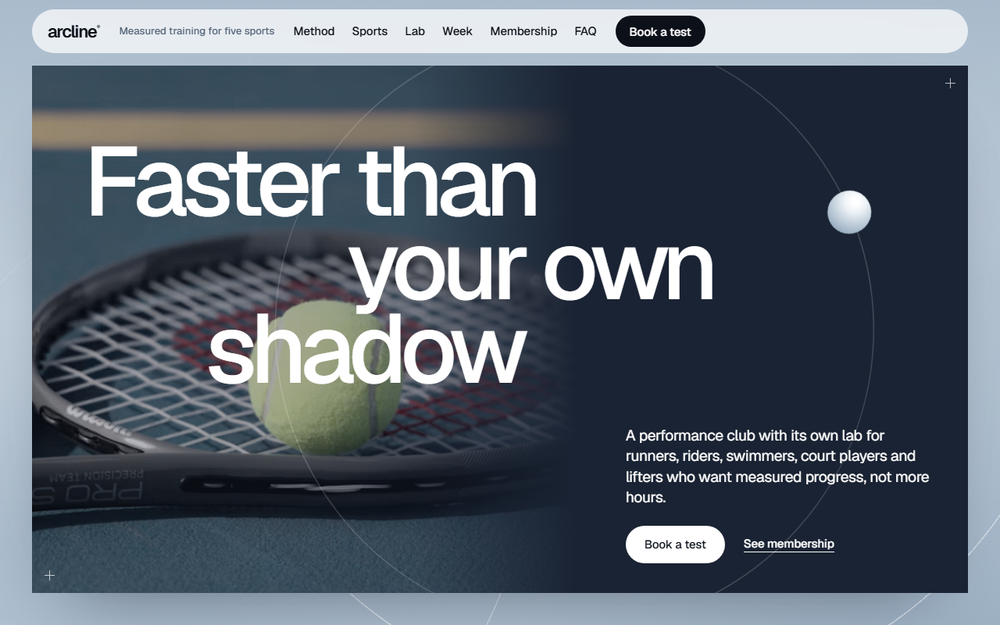
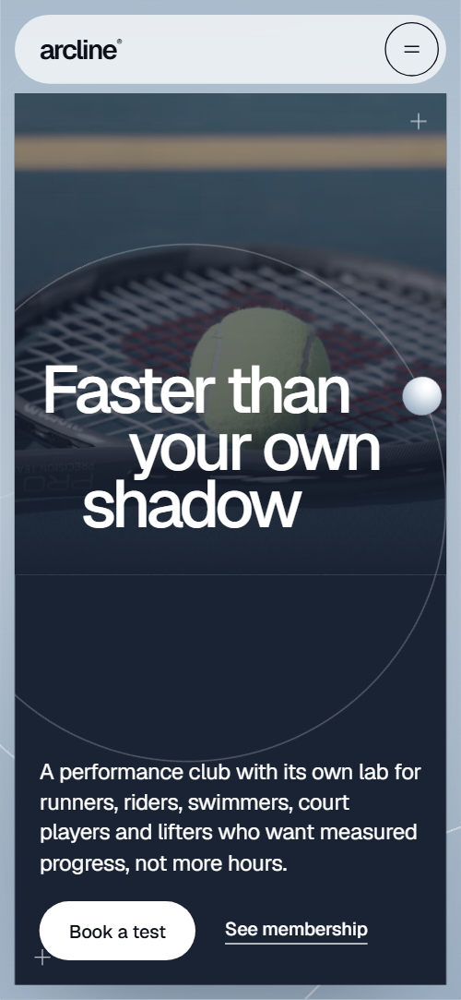
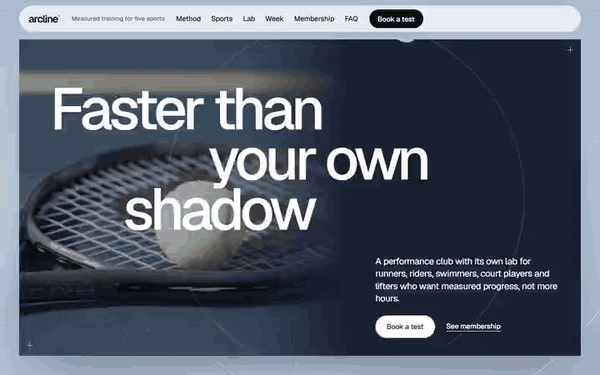

# Free HTML fitness website template with GSAP scroll animations — Arcline

**Website for a fitness or sports training club with coaches, a weekly schedule and membership plans: a free HTML template in one file, with GSAP scroll animations, no build step, MIT license. Made by [8B](https://8b.com/), the AI website builder.**

[](LICENSE)  

**[Live demo](https://8bsite.github.io/fitness-website-template/)** · **[Use this template](https://github.com/new?template_name=fitness-website-template&template_owner=8bsite)** · **[Download ZIP](https://github.com/8bsite/fitness-website-template/archive/refs/heads/main.zip)**

<a href="https://8bsite.github.io/fitness-website-template/"></a> <a href="https://8bsite.github.io/fitness-website-template/"></a>

<p align="center"><a href="https://8bsite.github.io/fitness-website-template/"></a><br><sub>Scroll animation</sub></p>

A one-page site for a performance training club with its own test lab, covering running, cycling, swimming, court sports and strength. Every section is a framed slide floating on a cold blue-grey mist: headings streak in and out like sprinters, tiles are dealt from a deck, a lens opens on the lab photo and the week's schedule runs sideways as you scroll.

Good for: gym, fitness or training club; running, cycling or triathlon coaching; personal trainer or coaching studio with membership plans; sports performance lab or physio clinic; multi-sport club with a weekly class schedule. Free for personal and commercial use (MIT), made by [8B](https://8b.com/).

## Quick start

Pick one:

- **With an AI coding agent** (Claude Code, Codex, Cursor, Windsurf…). Download the files into your project (in Windows PowerShell type `curl.exe`):
  ```bash
  curl -LO https://raw.githubusercontent.com/8bsite/fitness-website-template/main/index.html
  curl -LO https://raw.githubusercontent.com/8bsite/fitness-website-template/main/AGENTS.md
  curl -LO https://raw.githubusercontent.com/8bsite/fitness-website-template/main/LICENSE
  curl -LO https://raw.githubusercontent.com/8bsite/fitness-website-template/main/CREDITS.md
  ```
  Then give your agent this prompt:
  ```text
  Read AGENTS.md, then edit index.html. Use this template as the base for a site for <your gym, club or coaching business: what you train, where, coaches, schedule, prices, how to book>. Keep the layout, the motion and the single-file format; replace the brand name, copy, photos, coaches, schedule, prices, links and contacts, and recolour it through the CSS variables if needed.
  ```
  Give the agent the downloaded file, not a link: an agent reads a link as a summary and would rebuild a different page.
- **No code.** Download the ZIP, unzip it, replace the contacts and texts in `index.html`, put `index.html` into an empty folder and drag that folder onto [Netlify Drop](https://app.netlify.com/drop). The page is online in a minute.
- **On GitHub.** Click **[Use this template](https://github.com/new?template_name=fitness-website-template&template_owner=8bsite)** to get your own copy, then **Settings → Pages → Deploy from a branch → main**. Your site appears at `https://<you>.github.io/<repo>/`.

## What's on the page

- **Navigation** — top bar: wordmark, a short tagline, section links, Book a test button; phone menu overlay
- **Faster than your own shadow** — two-screen opening: a navy cover slide with a photo and a three-line stepped headline, then a pale manifesto slide (demo: racket photo, "Only forward®")
- **Tested Monday. Faster by spring** — how it works: three numbered steps beside a big heading with round photos set into its lines (demo: Test, Train, Transfer)
- **Breathe. Move. Repeat.** — a three-word line over a collage of tiles, one per activity, plus a link tile (demo: strength, running, cycling, swimming, gait fitting, court sports)
- **Coached by people who still race** — four coach portraits of different heights with names and roles
- **What the lab sees** — a feature block: text on the left, a round photo ringed by four labelled measures on the right (demo: test lab, VO₂ max, threshold)
- **A week at Arcline** — weekly schedule: seven day cards in a row that runs sideways as you scroll, with a progress line
- **Members, retested** — testimonials: one large quote with a round portrait in its first line and two short quotes
- **Recovery is part of the rep** — a stepped heading, a lead and four services in two columns, beside a window of sky over calm water (demo: recovery suite)
- **Membership** — pricing: three plans in ruled columns, the middle one highlighted
- **Before your first test** — questions and answers (native &lt;details&gt;) beside a rail with a rolling ball
- **Book your first test** — booking: a heading on a line across the slide, address, hours, phone, email and a short form (placeholders)
- **Footer** — width-filling wordmark, a line about the club, links, socials, copyright and the Design: 8B credit

## Before you publish

- Replace everything marked `data-8b-placeholder` (social preview image, favicon, phone, email, form, social) and the invented demo facts — prices, dates, address. [AGENTS.md](AGENTS.md) lists them.
- The contact form does not send anything yet: connect it to a form service (Formspree, Netlify Forms) or remove it; [AGENTS.md](AGENTS.md) shows both.

## Customize

- **Colours and fonts**: CSS variables in the `:root` block at the top of `<head>`.
- **Text**: edit it in place. A big display line with `style="--len:N"` fills its width: set N to its new number of characters.
- **Photos**: replace `src`, delete `srcset` and `sizes` (they list Unsplash sizes) and update the `alt` texts.
- **Animations**: each section's animation is one `<script data-8b-part="scene:<id>">` block at the end of the file. For native scroll, delete the Lenis block in `page-init`.

## For developers

- **Stack.** HTML and CSS (custom properties, cascade layers) with GSAP 3.13.0, ScrollTrigger, Lenis 1.3.27 from jsDelivr. No build step, no framework, no npm. 90 KB.
- **Layout of the file.** `<head>`: CSS variables, shared classes, then one style block per section. Then the markup, one element per section with a one-line comment above it. End of `<body>`: small behaviour scripts, the libraries, smooth scroll (`page-init`), the effects, one animation script per section.
- **Browsers.** Chrome and Edge 111+, Safari 16.2+, Firefox 113+ (it uses color-mix(), container query units, cascade layers, small/dynamic viewport units).
- **Accessibility.** Motion runs only when the visitor's system allows it; with "reduce motion" the page is complete and still. FAQ answers use native `<details>` and open without JavaScript. Every photo has alt text.
- **External requests.** fonts.gstatic.com, images.unsplash.com, cdn.jsdelivr.net. No analytics, no cookies. To self-host everything (offline use, or Google Fonts and GDPR in the EU), download those files and change the URLs.
- **Licences of the parts.** GSAP is free, commercial use included, under its own standard licence (not MIT); Lenis is MIT; fonts are SIL OFL; photos are under the Unsplash License. See [CREDITS.md](CREDITS.md).

## FAQ

**Can I use it for a client or a commercial site?** Yes. The code is MIT: use it, change it, sell the site you build with it.

**Do I have to keep the "Design: 8B" link?** No. It is welcome, not required.

**Can I use it in React, Next.js, Astro or Vue?** Yes. Move each section's markup and style block into a component and run its animation script in `useGSAP()` (React) or `onMounted` (Vue); start Lenis once. Or keep it as a separate static landing page next to your app (`example.com` for the landing, `app.example.com` for the app).

**Why doesn't the contact form send?** It is a demo. Connect it to Formspree, Netlify Forms or your backend; AGENTS.md has the steps.

**Where are the photos from?** Unsplash; they load from Unsplash's servers. Replace them with your own when you can.

## More free templates

[More 8B templates on GitHub](https://github.com/8bsite) · [8b.com](https://8b.com/)

## License

The template code is MIT licensed — see [LICENSE](LICENSE). Photos, fonts and libraries keep their own licences — see [CREDITS.md](CREDITS.md).
